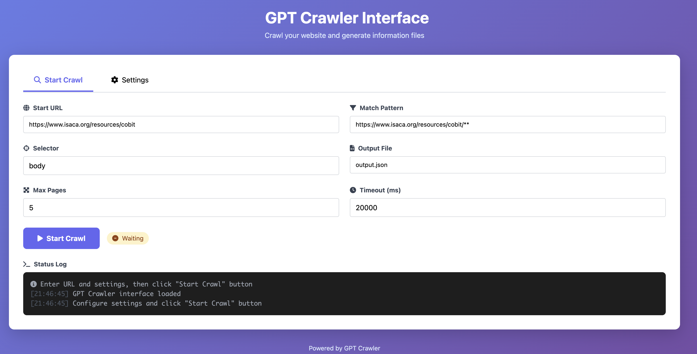

# GPT Crawler — Web Interface

**A browser-based interface for [Builder.io's GPT Crawler](https://github.com/BuilderIO/gpt-crawler).** Configure website crawls, collect content, and export results without manually editing crawler settings for every run.

> **Project attribution:** The original **GPT Crawler** was created by **[Builder.io](https://github.com/BuilderIO/gpt-crawler)**. This repository is an independently maintained modification that adds a browser-based interface and related usability features. The underlying crawler originates from Builder.io; the additional web interface development is by **[necrodin](https://github.com/necrodin)**. This project is not officially affiliated with or endorsed by Builder.io.



## Overview

[GPT Crawler](https://github.com/BuilderIO/gpt-crawler) crawls websites and generates content files that can be used as reference material for knowledge-based AI workflows, including custom GPTs.

**GPT Crawler — Web Interface** builds on that foundation by offering browser-based configuration and execution. Instead of editing a configuration file for each crawl, you can provide the target URL and extraction settings in a web interface and download the generated results.

## What's Added in This Version?

| Area | Web interface extension |
| --- | --- |
| Browser UI | Configure and launch crawling through a local web page |
| Crawl configuration | Set start URL, matching pattern, content selector, and page limit |
| Output naming | Generate filenames based on the target website's domain |
| Export options | Download collected output as JSON or Markdown |
| Presentation | Responsive, English-language interface styled with Tailwind CSS |

These are additions to the original project, **not a replacement for Builder.io's crawling engine**.


## Requirements

- **Node.js 16 or newer**, as specified by the upstream project's setup guidance. A maintained Node.js LTS release is recommended.
- **npm**
- A supported browser for the local web interface
- Network access to the websites you intend to crawl

The installation process installs Playwright browser dependencies as specified by the repository's npm scripts.

## Quick Start

### 1. Clone the repository

```bash
git clone https://github.com/necrodin/gpt-crawler-interface.git
cd gpt-crawler-interface
```

### 2. Install dependencies

```bash
npm install
```

### 3. Start the web interface

```bash
npm run start:web
```

### 4. Open the interface

Visit **http://localhost:3001** in your browser.

The `start:web` script is **already included** in `package.json`; you do not need to add it manually.

## How to Use

1. **Start URL:** Enter the website URL from which crawling should begin, for example `https://example.com`.
2. **Match Pattern:** Specify which URLs should be included, for example `https://example.com/**`.
3. **Selector:** Choose the page content to extract with a selector, such as `body` or `.main-content`.
4. **Max Pages:** Set the maximum number of pages to crawl.
5. **Output File:** Specify an output filename if needed, or use domain-based automatic naming.
6. Select **Start Crawl** and wait for the crawl to complete.
7. Download the results in **JSON** or **Markdown** format.

### Example Configuration

For a crawl of a documentation site, use values similar to:

| Setting | Example |
| --- | --- |
| Start URL | `https://example.com/docs` |
| Match Pattern | `https://example.com/docs/**` |
| Selector | `main` |
| Max Pages | `50` |
| Output File | Automatically generated |

You can also edit [`config.ts`](config.ts) directly when using the underlying crawler outside the browser UI.

## Output Files

Crawler results are written to the `output/` directory. This interface supports **JSON** and **Markdown** downloads, with domain-based filenames when automatic naming is enabled.

For example, crawling `https://example.com` can produce files such as:

```text
output/
├── example.com.json
└── example.com.md
```

Actual filenames depend on the URL and output settings. The Markdown export is provided for convenient reading and reuse; check the exported content for completeness before using it as a production knowledge source.

## Available Commands

| Command | Purpose |
| --- | --- |
| `npm run start:web` | Build and run the web interface |
| `npm run start:webdev` | Run the repository's web development entry point |
| `npm run build` | Compile the TypeScript project |
| `npm run start:cli` | Run the original crawler CLI entry point |
| `npm run start:server` | Run the original API server in development mode |

## Responsible Crawling & Security

- Crawl only websites you have permission to access, and respect applicable terms and rate limits.
- Avoid collecting personal, confidential, or otherwise sensitive information without authorization.
- Review generated output before sharing or uploading it to third-party AI services.
- **The web interface should be treated as a local development tool unless you have independently reviewed and secured it.** Do not expose it directly to the public internet without access controls and appropriate security testing.
- When operating on untrusted URLs, evaluate server-side request risks, including access to private or internal network resources.

## Original Project & Acknowledgments

The core crawler is based on the open-source project:

**[Builder.io / GPT Crawler](https://github.com/BuilderIO/gpt-crawler)**  
Original project and crawling engine: **Builder.io and its contributors**

This repository extends that work with a browser-based interface and related user-experience improvements developed by **[necrodin](https://github.com/necrodin)**.

We thank the Builder.io team and all upstream contributors for creating and maintaining the original GPT Crawler. For documentation about the original crawling engine and its broader capabilities, see the [upstream README](https://github.com/BuilderIO/gpt-crawler#readme).

This is an independent community modification, not an official Builder.io release.

## License

**GPT Crawler with Web Interface is free and open-source software.**

This repository is distributed under the **ISC License**, a permissive open-source license that permits anyone to use, copy, modify, distribute, and commercially use the software, subject to retaining the applicable copyright and permission notices. See the repository’s [`License`](License) file for the complete terms.

- **Original GPT Crawler:** © 2023 BuilderIO and its contributors — [Builder.io / GPT Crawler](https://github.com/BuilderIO/gpt-crawler), ISC License.
- **Web interface and additional development:** © 2026 [necrodin](https://github.com/necrodin) — distributed as part of this open-source repository under the ISC License.

This is an independent community extension and is not officially affiliated with or endorsed by Builder.io. Original copyright and license notices must be preserved when redistributing the software.

---

**Original crawler:** [Builder.io / GPT Crawler](https://github.com/BuilderIO/gpt-crawler) · **Web interface development:** [necrodin](https://github.com/necrodin)
